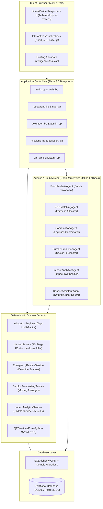
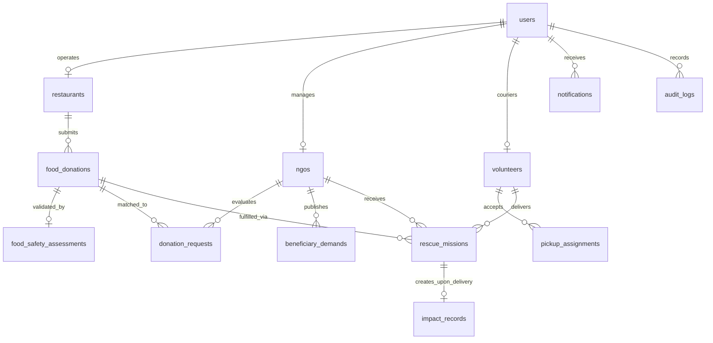

# ANNADATA AI — Intelligent Food Rescue & Community Impact Network

> *"Every Meal Matters. Every Rescue Counts."*

[](https://www.python.org/)
[](https://flask.palletsprojects.com/)
[](https://www.sqlalchemy.org/)
[-18A875?style=flat&logo=checkmarx&logoColor=white)](tests/)
[](docs/architecture.md)
[](#)

---

## 📖 Executive Summary & Academic Purpose

**ANNADATA AI** is an enterprise-grade, full-stack food rescue platform engineered for non-profit organizations, municipal food safety authorities, and commercial hospitality networks. Developed for final-year engineering capstone evaluation and genuine NGO field deployment, ANNADATA AI bridges the gap between commercial surplus food generation and acute urban hunger through deterministic food safety screening, explainable multi-factor NGO matching, volunteer logistics coordination, tamper-evident QR traceability, and predictive surplus forecasting.

The platform eliminates the common failure modes of typical food donation systems—namely, liability fear, lack of real-time logistics, donation hoarding by large charities, and fabricated impact statistics.

---

## 🌟 The 6 Core Features of ANNADATA AI

### 1. AI Food Rescue Intelligence & Predictive Surplus Center
- **Explainable Statistical Forecasting:** Learns from historical donation logs to model recurring surplus trends across days of the week, times of day, and commercial restaurant clusters.
- **Volunteer Capacity Planning:** Calculates expected surplus volume (kg) and automatically advises how many volunteer couriers should be mobilized in specific sectors (e.g., Koramangala or Indiranagar).
- **Graceful Baseline Mode:** When fewer than 5 historical records exist, the engine explicitly indicates insufficient data and activates a transparently labeled `[Simulated Baseline Mode]` without fabricating statistical certainty.

### 2. Tamper-Evident Food Rescue Passport & Public QR Verification
- **Automated Digital Passport:** Every accepted donation receives a unique rescue identifier (`ANN-RESCUE-YYYYMMDD-XXXX`) and an in-house pure-Python SVG QR code with Reed-Solomon Error Correction Code (Level M).
- **Public-Safe Verification:** Anyone scanning the QR code on a food container is directed to a public verification page (`/passport/<rescue_code>`) confirming food provenance, preparation timestamp, temperature category, and safety checklist without leaking private donor telephone numbers or recipient addresses.
- **Safety Boundary:** AI is strictly prohibited from certifying food as safe. Food safety determinations are governed by an explicit 5-point physical verification checklist and authorized human sign-off.

### 3. 100-Point Smart NGO Allocation Engine
- **Multi-Factor Transparent Scoring:** Replaces naive proximity-only matching with an explainable 100-point multi-attribute algorithm:
  - **Distance & Travel Time (25 pts):** Calculated using Haversine geodesic coordinates and estimated urban transit speed.
  - **Category Compatibility (25 pts):** Strict alignment with the NGO's dietary preferences (cooked meals, vegetarian, rations).
  - **Capacity Utilization (20 pts):** Evaluates if donation volume fits the NGO's active shelter population (penalizing oversaturation).
  - **Active Beneficiary Demand (15 pts):** Prioritizes shelters that logged urgent active demands for specific food types.
  - **Volunteer Readiness (5 pts):** Checks for available couriers within an 8 km operational radius.
  - **7-Day Rolling Fairness Balancing (10 pts):** Prevents donation hoarding by penalizing NGOs that received disproportionate surplus in the past 7 days.
- **Deterministic & Auditable:** Scoring is computed deterministically in Python; AI is utilized exclusively to generate natural language explanations for human administrators.

### 4. 10-Stage Rescue Mission Management & Cryptographic PIN Handover
- **Immutable State Machine:** Every accepted donation transitions through an immutable 10-stage server-side lifecycle:
  `submitted` $\to$ `safety_screening` $\to$ `ngo_matching` $\to$ `ngo_accepted` $\to$ `volunteer_assigned` $\to$ `pickup_initiated` $\to$ `food_collected` $\to$ `delivery_initiated` $\to$ `delivery_confirmed` $\to$ `completed`.
- **Two-Factor Digital Handover PINs:**
  - `pickup_pin`: 4-digit code known only to the Restaurant kitchen manager, verified by the volunteer upon collection.
  - `delivery_pin`: 4-digit code known only to the NGO shelter lead, verified upon physical arrival at the shelter.
- **Audit Logging:** Every state transition records timestamp, responsible user ID, IP address, and transition rationale in `AuditLog`.

### 5. Emergency Rescue Escalation Protocol
- **Deadline Monitoring Scanner:** Background service that continuously scans uncollected perishable donations. When time remaining until the collection deadline falls below **2 hours**, the donation is escalated to Emergency Mode (`is_emergency = True`).
- **Multi-Channel Alerting:** Dispatches high-priority notifications to nearby verified relief NGOs and volunteers.
- **Backup Routing:** Immediately computes up to three alternative eligible relief shelters if the primary NGO is unresponsive.

### 6. Scientific Impact Analytics (FAO / UNEP Calibrated)
- **Verified Delivered-Only Accounting:** Unverified, pending, or cancelled donations are strictly excluded from impact calculations.
- **Documented Scientific Assumptions:**
  - **Greenhouse Gas Avoidance:** $2.5\text{ kg CO}_2\text{e}$ averted per $1\text{ kg}$ edible food diverted from landfill anaerobic decay (UNEP Food Waste Index standard).
  - **Freshwater Conservation:** $250\text{ Liters}$ embedded agricultural water conserved per $1\text{ kg}$ prepared food (Water Footprint Network benchmark).
  - **Meal Conversion:** Standardized portion equivalent of $0.40\text{ kg}$ (400 grams) per nutritious adult meal.
- **Interactive Visualizations:** Dynamic Chart.js trends, food category splits, and NGO/volunteer leaderboards.

---

## 🏛️ System Architecture



---

## 📊 Database Schema (Entity-Relationship)



*For complete field-by-field database definitions and constraints, see [docs/database_er.md](docs/database_er.md).*

---

## 🛠️ Technology Stack & Library Justifications

| Component | Technology | Rationale & Advantage |
| :--- | :--- | :--- |
| **Backend Framework** | Python 3.11+ / Flask 3.0.3 | Lightweight, mature, robust WSGI architecture with zero unnecessary microservice overhead. |
| **Database ORM** | Flask-SQLAlchemy 3.1.1 / Alembic | Robust relational schema enforcement, relationship cascade management, and version-controlled migrations. |
| **Session & Security** | Flask-Login 0.6.3 / Werkzeug | Secure salted PBKDF2 password hashing, HTTP-only session cookies, and strict Role-Based Access Control (RBAC). |
| **QR Code Engine** | In-House Pure-Python `QRService` | Self-contained Reed-Solomon ECC generator. Zero binary dependencies, zero PIL/C-extension compilation headaches on Windows. Outputs pure W3C SVG XML. |
| **Front-End Design** | Vanilla CSS3 Custom Tokens | Modern SaaS aesthetic inspired by Linear, Stripe, and Vercel. Deep forest green (`#123D32`), Emerald (`#18A875`), and Warm Amber (`#F4B942`). Zero heavy CSS frameworks. |
| **Interactive Visuals** | Chart.js 4.4 + Leaflet.js 1.9 | Responsive canvas charts and interactive OpenStreetMap geolocation rendering with custom rescue markers. |
| **Agentic AI Engine** | OpenRouter API + Deterministic Fallback | Hybrid resilience: utilizes high-capability cloud LLMs when configured, but operates with 100% functionality offline through deterministic rule engines when no API key is present. |

---

## 🚀 Quick Start Guide (Windows PowerShell)

### 1. Prerequisites
- **Python 3.11+** installed and added to your system `PATH`.
- **Git** (optional).

### 2. Clone / Open Project
```powershell
cd C:\Users\hruda\Downloads\xxx
```

### 3. Initialize Python Virtual Environment
```powershell
# Create virtual environment (if not already created)
python -m venv venv

# Activate virtual environment
.\venv\Scripts\Activate.ps1
```

### 4. Install Dependencies
```powershell
pip install -r requirements.txt
```

### 5. Configure Environment Variables
Copy `.env.example` to `.env` (never commit your active `.env` file):
```powershell
Copy-Item .env.example .env
```
*Note: An OpenRouter API key is completely optional. If `OPENROUTER_API_KEY` is omitted, the application operates smoothly using its built-in local deterministic fallback engines.*

### 6. Apply Database Migrations & Seed Sample Data
```powershell
# Apply Alembic schema migrations
$env:FLASK_APP="run.py"
flask db upgrade

# Populate realistic academic demo data
python -m seeds.sample_data
```

### 7. Run Development Server
```powershell
python run.py
```
Open your browser at: **`http://127.0.0.1:5000`**

---

## 🔑 Demo Evaluation Credentials

The database comes pre-seeded with realistic demonstration accounts across all four system roles for academic assessment and viva demonstrations:

| Role | Email Address | Password | Sample Entity & Description |
| :--- | :--- | :--- | :--- |
| **Food Donor (Restaurant)** | `restaurant@example.com` | `password123` | **Golden Spoon Banquet & Bistro** (Indiranagar, Bengaluru). Multi-cuisine donor with active surplus. |
| **Relief NGO** | `ngo@example.com` | `password123` | **Asha Deep Community Shelter** (Koramangala, Bengaluru). 120-person capacity, active cooked meal demand. |
| **Rescue Volunteer** | `volunteer@example.com` | `password123` | **Vikram Rathod** (Two-Wheeler courier with insulated carrier bag, 8 km radius). |
| **Platform Administrator** | `admin@example.com` | `admin123` | **ANNADATA Operations Command Center** (Full system audit logs, agent monitor, user management). |

*Quick Evaluation Tip: The login screen at `/login` provides 1-click credential auto-fill buttons for rapid role switching.*

---

## 🧪 Automated Testing & Verification Suite

ANNADATA AI includes a comprehensive test suite covering 18 unit/integration scenarios and end-to-end component verification scripts.

### Run All 18 Test Scenarios
```powershell
.\venv\Scripts\python.exe -m unittest discover tests
```
*Output: `Ran 18 tests in ~5s ... OK (100% Pass)`*

### Run 26-Route HTTP Status Crawler
```powershell
.\venv\Scripts\python.exe check_app.py
```
*Output: `ALL 26 ROUTES RETURNED HTTP 200 OK!`*

### Run End-to-End Mission & Subsystem Verifier
```powershell
.\venv\Scripts\python.exe verify_workflow.py
```
*Verifies the complete 10-stage lifecycle, RBAC barriers, QR Passport, Emergency escalation, and offline AI agent resilience.*

---

## 📡 REST API Reference

ANNADATA AI exposes a secure JSON API under `/api` for external integrations, municipal telemetry, and mobile client apps:

| Method | Endpoint | Description | Auth Required |
| :--- | :--- | :--- | :--- |
| `GET` | `/api/intelligence/forecast` | Returns sector forecasts, day-of-week moving averages, and volunteer preparation advisories. | No |
| `GET` | `/api/impact/stats` | Returns verified delivered food metrics (kg, meals, CO₂e, water saved, category breakdown). | No |
| `GET` | `/api/map/data` | Returns active geo-coordinates for donations, NGOs, volunteers, and transit routes. | No |
| `GET` | `/api/emergencies` | Returns active emergency donations nearing the 2-hour deadline threshold. | No |
| `GET` | `/passport/<rescue_code>` | Returns public-safe HTML Food Rescue Passport. | No |
| `GET` | `/passport/<rescue_code>/qr.svg` | Generates on-the-fly pure SVG QR code image for packaging labels. | No |
| `POST` | `/api/assistant/chat` | Conversational endpoint powering the floating Annadata Intelligence assistant. | Yes |
| `POST` | `/api/volunteer/toggle-status` | Toggles volunteer courier availability between Online and Offline. | Yes (Volunteer) |
| `POST` | `/api/demand/log` | Allows NGOs to submit real-time community beneficiary demand. | Yes (NGO) |

---

## 📑 Project Directory Structure

```
FoodWasteAI/
├── app/
│   ├── __init__.py              # Flask app factory with blueprint registration
│   ├── config.py                # Environment configuration & defaults
│   ├── extensions.py            # SQLAlchemy, LoginManager, Migrate instances
│   ├── models.py                # 16 Relational models & audit tables
│   ├── agents/                  # 6 Autonomous AI agents
│   │   ├── base_agent.py        # Base agent with audit logging
│   │   ├── food_analysis_agent.py
│   │   ├── ngo_matching_agent.py
│   │   ├── coordination_agent.py
│   │   ├── surplus_prediction_agent.py
│   │   ├── impact_analytics_agent.py
│   │   └── rescue_assistant_agent.py
│   ├── services/                # 7 Deterministic domain services
│   │   ├── allocation_service.py # 100-point multi-factor NGO allocator
│   │   ├── mission_service.py   # 10-stage FSM & PIN handover
│   │   ├── emergency_service.py # 2-hour deadline escalation scanner
│   │   ├── forecast_service.py  # Moving averages surplus forecasting
│   │   ├── impact_service.py    # UNEP/FAO scientific impact calculator
│   │   ├── assistant_service.py # Role-scoped conversational assistant
│   │   ├── qr_service.py        # Pure-Python SVG QR code engine
│   │   └── llm_service.py       # OpenRouter client with offline fallback
│   ├── routes/                  # 15 Flask blueprints
│   │   ├── auth.py              # Login, register, logout, role routing
│   │   ├── restaurant.py        # Donation wizard & donor dashboard
│   │   ├── ngo.py               # Allocation review & demand logging
│   │   ├── volunteer.py         # Mission claims & transit updates
│   │   ├── admin.py             # Operations command center & audit logs
│   │   ├── missions.py          # Mission detail & PIN verification
│   │   ├── passport.py          # Public QR passport verification
│   │   ├── intelligence.py      # AI intelligence center
│   │   ├── impact.py            # Scientific impact analytics
│   │   ├── map.py               # Live rescue radar map
│   │   ├── notifications.py     # User notifications & alert inbox
│   │   ├── profile.py           # User account settings
│   │   ├── assistant.py         # Assistant chat API
│   │   └── api.py               # Public REST telemetry endpoints
│   └── tools/
│       ├── geo_tools.py         # Haversine distance & travel time
│       └── safety_rules.py      # IST-referenced 5-point safety checker
├── docs/                        # Complete technical documentation
│   ├── problem_statement.md     # Problem background & solution analysis
│   ├── architecture.md          # System & agent architecture specs
│   ├── database_er.md           # Database ER diagram & table dictionary
│   └── workflow.md              # 10-stage FSM & sequence diagrams
├── migrations/                  # Alembic database migration versions
├── seeds/
│   └── sample_data.py           # Realistic seed dataset for academic viva
├── static/
│   ├── css/style.css            # Linear/Stripe design tokens & styling
│   └── js/main.js               # Dynamic client controllers & toasts
├── templates/                   # 22 Jinja2 responsive templates
│   ├── base.html                # App shell, navigation & floating AI widget
│   ├── home.html                # Public landing page with live telemetry
│   ├── auth/                    # Login (with 1-click fill) & register
│   ├── restaurant/              # 6-step donation wizard & donor views
│   ├── ngo/                     # NGO dashboard, capacity meter & demands
│   ├── volunteer/               # Courier dispatch & transit controls
│   ├── admin/                   # Network health, user & agent audit logs
│   ├── missions/                # 10-stage timeline & PIN verification
│   ├── passport/                # Public-safe QR verification page
│   ├── intelligence/            # Sector forecasts & operational insights
│   ├── impact/                  # Chart.js impact analytics & leaderboards
│   └── map/                     # Leaflet.js live rescue radar map
├── tests/
│   └── test_scenarios.py        # 18 Automated scenario test cases
├── check_app.py                 # 26-Route HTTP status validation script
├── verify_workflow.py           # Comprehensive end-to-end verifier
├── run.py                       # WSGI server entry point
└── requirements.txt             # Lightweight Python package dependencies
```

---

## ⚖️ Ethical AI Principles & Safety Disclaimer

1. **Food Safety Authority:** ANNADATA AI enforces the principle that **AI models shall never certify food as safe for human consumption**. Food suitability is evaluated using deterministic, non-negotiable microbiological safety rules (maximum 4-hour room temperature window, preparation time verification, allergen disclosure, and packaging integrity).
2. **Fairness Over Proximity:** To prevent algorithmic bias where well-funded or prominent NGOs receive all surplus, the allocation engine includes a rolling 7-day fairness penalty, ensuring equitable food distribution to grassroots shelters.
3. **Data Privacy Compliance:** Food Rescue Passports accessible via public QR codes sanitize sensitive donor telephone numbers, kitchen contact details, and recipient shelter locations to protect donor liability and beneficiary dignity.
4. **Environmental Honesty:** All carbon reduction ($2.5\text{ kg CO}_2\text{e}/\text{kg}$) and water conservation ($250\text{ L}/\text{kg}$) figures are transparently labeled as scientific estimates based on published UNEP/FAO benchmarks. Only verified, delivered food is accounted for.

---

## 🎓 Academic Viva & Evaluation Notes

- **Capstone Topic:** Intelligent Food Rescue & Community Impact Network
- **Architecture Type:** Domain-Driven Layered Architecture with Autonomous Agentic Subsystems
- **Key Contributions:**
  1. Deterministic food safety verification pipeline with pure-Python QR ECC traceability.
  2. Explainable 100-point multi-attribute allocation algorithm with anti-hoarding fairness balancing.
  3. Strict 10-stage finite state machine with dual-PIN cryptographic handover verification.
  4. Moving-average surplus forecasting with graceful, transparent baseline simulation mode.
  5. 100% offline operational resilience with zero runtime proprietary cloud lock-in.
