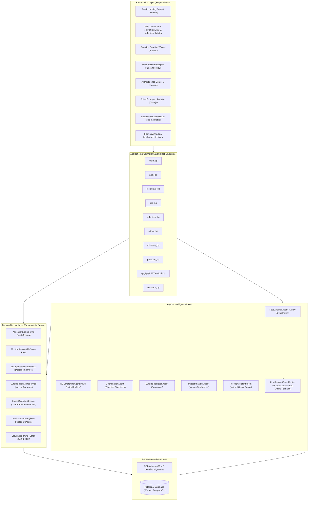

# ANNADATA AI — System Architecture & Agent Specifications

## 1. High-Level Architectural Overview

ANNADATA AI is designed following a modular, layered service-oriented architecture (SOA) emphasizing clean separation of concerns, deterministic safety barriers, role-scoped authorization, and offline-first resilience.

---

## 2. Agentic Intelligence Specifications

The platform features six specialized autonomous agents. In adherence to strict enterprise reliability standards, all agents utilize **deterministic business logic for decisions and calculations**, while LLMs are utilized for semantic understanding, contextual explanation, and natural query synthesis. If an external API key is absent or network fails, all agents automatically degrade gracefully into local deterministic mode without throwing exceptions.

### 2.1 FoodAnalysisAgent
- **Responsibilities:**
  - Evaluates raw donation inputs against the 5-point food safety checklist (temperature, visual inspection, packaging integrity, allergen declaration, and hygiene).
  - Determines statutory safety suitability score (0.0 to 1.0) and generates safety reports.
  - Automatically provisions the unique `rescue_code` (`ANN-RESCUE-YYYYMMDD-XXXX`).
  - Infers canonical category taxonomy (e.g., classifying "Palak Paneer" as "Cooked Meals / Vegetarian").
- **Offline Fallback:** Heuristic keyword classifier mapping common culinary terms into 10 standard categories.

### 2.2 NGOMatchingAgent
- **Responsibilities:**
  - Invokes `AllocationEngine.rank_ngos_for_donation(donation)`.
  - Applies 6-factor deterministic scoring (0–100 scale).
  - Idempotently creates `DonationRequest` records for top matching NGOs while preventing duplicate spamming.
- **Offline Fallback:** 100% deterministic local calculation.

### 2.3 CoordinationAgent
- **Responsibilities:**
  - Coordinates real-time dispatch between confirmed donor, accepting NGO, and nearby available volunteers.
  - Generates travel distance calculations, estimated transit durations, and generates two unique 4-digit verification PINs (`pickup_pin` and `delivery_pin`).
- **Offline Fallback:** 100% deterministic local calculation.

### 2.4 SurplusPredictionAgent
- **Responsibilities:**
  - Aggregates historical donation logs to model day-of-week and time-of-day surplus patterns.
  - Generates moving averages, confidence ratings, and sector-based volunteer preparation advisories.
- **Offline Fallback:** Activates calibrated benchmark model labelled as `[Simulated Baseline Mode]` when fewer than 5 historical donations exist.

### 2.5 ImpactAnalyticsAgent
- **Responsibilities:**
  - Synthesizes verified social and environmental metrics strictly from completed rescue missions.
  - Prepares structured datasets for interactive Chart.js dashboards (monthly trends, food category splits, volunteer and NGO leaderboards).
- **Offline Fallback:** 100% deterministic local calculation.

### 2.6 RescueAssistantAgent & AssistantService
- **Responsibilities:**
  - Provides a floating conversational interface accessible across all authenticated dashboards.
  - Role-scoped context injection:
    - *Restaurant:* Surplus trends, active donation statuses, kitchen scheduling tips.
    - *NGO:* Incoming requests, emergency warnings, active inbound missions, community demand logs.
    - *Volunteer:* Next assigned pickup, navigation instructions, delivery PIN verification steps.
    - *Admin:* Network health, registered participant statistics, agent execution audit logs.
- **Offline Fallback:** High-precision deterministic template responses populated with real-time database counts and records.

---

## 3. Pure-Python QR Code Generation Service (`QRService`)
To eliminate third-party binary C-extensions (like libqrencode or PIL image compilation issues on Windows), `QRService` provides an in-house implementation:
- Full Reed-Solomon Error Correction Code (ECC) Level M (15% recovery capacity).
- Strict Byte-mode encoding with standard QR masking patterns.
- Outputs pure W3C-compliant SVG XML strings and base64 `data:image/svg+xml;base64,...` Data-URIs.
- High resolution, infinite scalability, and zero external package dependencies.
