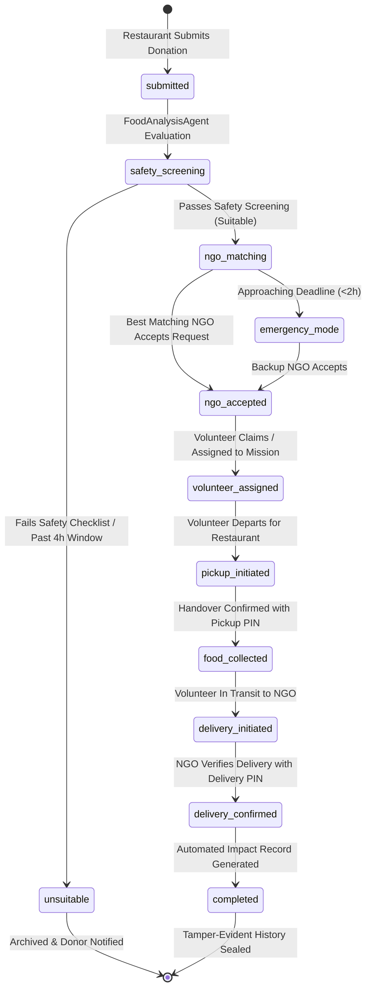
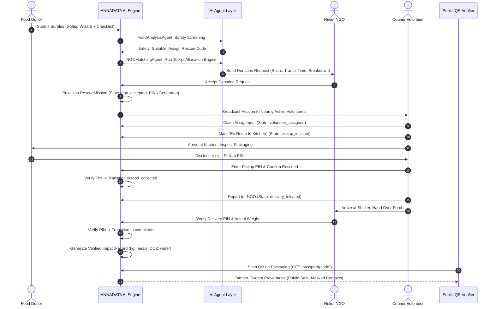

# ANNADATA AI — Operational Workflows & State Machine Specifications

## 1. 10-Stage Rescue Mission Lifecycle (FSM)

The lifecycle of every accepted food rescue is governed by an immutable finite state machine enforced on the backend. Arbitrary status skipping is rejected with strict validation errors.

---

## 2. End-to-End Rescue Sequence Diagram

The interaction flow across all four roles and platform services:

---

## 3. Handover PIN Security Protocol

To prevent phantom collections, incorrect drop-offs, or malicious confirmation:
1. **Pickup Verification PIN (`pickup_pin`):**
   - Automatically generated as a cryptographic 4-digit code.
   - Displayed *only* to the Restaurant donor on their donation details dashboard.
   - The courier volunteer must obtain the code from the kitchen manager at physical handover and submit it via `/missions/<id>/handover`.
2. **Delivery Verification PIN (`delivery_pin`):**
   - A separate cryptographic 4-digit code generated upon mission creation.
   - Displayed *only* to the receiving NGO contact person on their mission management page.
   - Entered upon physical delivery to verify quantity, condition, and beneficiary reception.

---

## 4. Emergency Rescue Escalation Mode

When a perishable donation's collection deadline drops below the **2-hour critical threshold** without an accepted mission:
1. The background emergency scanner flags the donation (`is_emergency = True`).
2. Immediate push notifications and visual amber/red banners are displayed across all active NGOs within a 15 km radius.
3. The allocation engine identifies up to 3 alternative nearby relief shelters with matching category capacity.
4. Active volunteers receive an expedited dispatch alert to prioritize pickup before spoilage.
